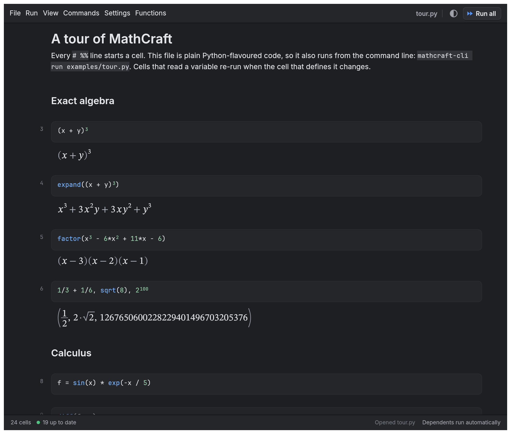

# MathCraft

A fast, friendly, open-source symbolic-computation notebook in pure Rust. Exact algebra and calculus, a Python-flavoured
language, and a reactive notebook where changing one cell updates every cell that depends on it.



**Status: v0.1.1, early but usable.** It works and is usable, but it is young: expect rough edges, and see
[Limitations](#limitations). Built and tested mainly on macOS (Apple silicon); Windows and Linux builds come from CI
and have had little hands-on use.

## Install

Download a build for your system from the [Releases](../../releases) page, or build from source (Rust 1.97 or newer):

```sh
cargo install --path apps/mathcraft        # the desktop app
cargo install --path apps/mathcraft-cli    # the command line tool
```

On Linux you also need the usual GUI development libraries (`libxkbcommon-dev`, `libwayland-dev`, `libgtk-3-dev`).

## Try it

```sh
cargo run --release -p mathcraft                         # opens a welcome notebook
cargo run --release -p mathcraft -- examples/tour.py     # open a file
cargo run --release -p mathcraft-cli -- eval 'integrate(sin(x)**2, (x, 0, pi))'
cargo run --release -p mathcraft-cli -- run examples/tour.py
cargo run --release -p mathcraft-cli -- check examples/tour.py
```

In the app: **Shift+Enter** runs a cell and moves on, **⌘/Ctrl+Enter** runs without moving, **⌘⇧+Enter** runs all,
**⌘.** interrupts, **⌘S** saves, **F1** lists every function.

## The language

Python syntax, with maths-friendly meaning:

```python
f = sin(x) * exp(-x / 5)         # x is not defined, so it is a symbol
diff(f, x)                       # exp(-x/5)*cos(x) - exp(-x/5)*sin(x)/5
1/3 + 1/6                        # 1/2, exact
solve(x**2 - 5*x + 6, x)         # [2, 3]
integrate(sin(x)**2, (x, 0, pi)) # pi/2
A = [[1, 2], [3, 4]]
det(A), inv(A), A @ A
plot([sin(x), cos(x)], (x, 0, 10))
```

Use `**` for powers (`^` is XOR in Python and gives a helpful error). Declare symbols explicitly with
`x, y = symbols('x y')`, or turn on *Strict* in Settings to require it. Add assumptions with
`x = symbols('x', positive=True)` (also `integer`, `negative`, `nonzero`, ...) so `sqrt(x**2)` simplifies to `x`.

## Notebook rules (inspired by marimo)

- A name can be defined in **one cell only**; no two cells may depend on each other in a cycle. Offending cells don't
  run and say why (`MC002` duplicate definition, `MC003` cycle, `MC001` syntax error).
- Running a cell re-runs the cells that use what it defines (or marks them stale in *lazy* mode).
- Names starting with `_` are private to a cell.
- Files are plain scripts with `# %%` markers, so they diff well in git and also run from the command line.
  Outputs are not stored in the file.

## Limitations

- No classes, imports, dicts or sets in the language yet (a clear message names the line).
- `solve` handles polynomials up to degree 4 in closed form (`nroots` for any degree), simple log/exp/trig equations
  and linear systems; no nonlinear systems or inequalities.
- `integrate` has no special functions; an integral with no closed form stays as `integrate(...)`.
- Outputs are not saved in the file; no cell-level undo; no interactive sliders yet.
- The interpreter is a tree walker, about 3x slower than CPython on plain scalar loops. Algebra is the strength.

## Also included

- Scattering amplitudes: Dirac traces and Lorentz-index contraction (`gamma_trace`, `slash`, `contract`, ...). `examples/amplitudes.py`
  derives the e⁺e⁻ → μ⁺μ⁻ cross-section 4πα²/(3s). Four dimensions only, no `γ5` yet.
- `mathcraft-cli mcp` runs an MCP server so AI tools can evaluate expressions and check notebooks.
- Optional Vim keys (Settings), a Text view of the whole file, a command palette (⌘/Ctrl+P), tabs and a folder sidebar.
- Right-click a result to copy it as text, LaTeX, Python, NumPy or Rust.

## Develop

Rules for contributors: `AGENTS.md`.

```sh
cargo fmt --all && cargo clippy --workspace --all-targets -- -D warnings && cargo test --workspace && cargo deny check
```

Change history: [docs/CHANGELOG.md](docs/CHANGELOG.md).

## Licence

Dual-licensed under [MIT](LICENSE-MIT) or [Apache-2.0](LICENSE-APACHE), at your option.
