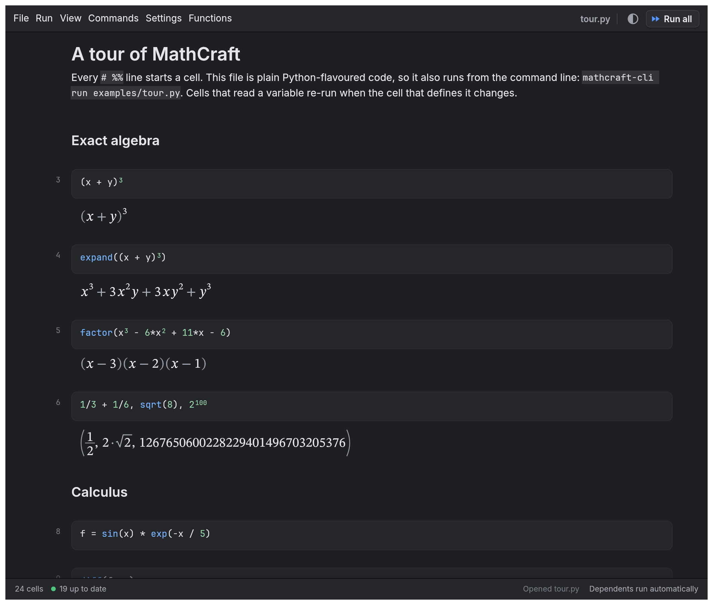

# MathCraft

A notebook for doing maths on a computer: type an expression, get an exact answer. Algebra, calculus, equations, matrices
and plots, with Python-style syntax, in one small app you download and open. No Python, no installer, no account.



```python
f = sin(x) * exp(-x / 5)          # x is not defined, so it is a symbol
diff(f, x)                        # exp(-x/5)*cos(x) - exp(-x/5)*sin(x)/5
solve(x**2 - 5*x + 6, x)          # [2, 3]
integrate(sin(x)**2, (x, 0, pi))  # pi/2
plot(f, (x, 0, 20))               # a plot, right under the cell
```

**Status: v0.6.0, early but usable.** It works, but it is young: expect rough edges, and read [What does not work yet](#what-does-not-work-yet).
It is built and tested mainly on macOS (Apple silicon); the Windows and Linux builds come from CI and have had little
hands-on use.

## Who it is for

- Students and teachers who want a symbolic calculator that shows exact results (`1/3 + 1/6` is `1/2`, `sqrt(8)` is
  `2*sqrt(2)`), typeset like a textbook.
- People who know a little Python and want algebra without installing SymPy, Sage or a Python environment.
- Physicists: it can do Dirac traces and Lorentz contractions (see [Also included](#also-included)).
- Anyone who wants notebooks as plain text files that diff well in git.

It is not a replacement for Mathematica, Maple or Sage; see [What does not work yet](#what-does-not-work-yet).

## Install (about two minutes)

1. Open the [Releases](../../releases) page and download the file for your computer from the newest release:

   | System | File | Then |
   |---|---|---|
   | macOS | `mathcraft-<version>-macos-arm64-app.zip` (Apple silicon: M1 and later) or `...-macos-x64-app.zip` (Intel) | Unzip, drag `MathCraft.app` to Applications. It is not signed yet, so the first time right-click it and choose **Open**. |
   | Windows | `mathcraft-<version>-windows-x64.zip` | Unzip and double-click `mathcraft.exe`. Windows may warn about an unknown publisher (not signed yet): choose **More info**, then **Run anyway**. |
   | Linux | `mathcraft-<version>-linux-x64.tar.gz` | Extract and run `./mathcraft`. |

2. Open the app. The first notebook that opens is a tutorial and reference: every feature, with cells you can run.

The same downloads contain `mathcraft-cli`, a command line tool. `mathcraft-cli-<version>-<system>` is the command line tool
alone (no window system needed).

<details>
<summary>Build from source instead (Rust 1.97 or newer)</summary>

```sh
cargo install --path apps/mathcraft        # the desktop app
cargo install --path apps/mathcraft-cli    # the command line tool
```

On Linux you also need the usual GUI development libraries (`libxkbcommon-dev`, `libwayland-dev`, `libgtk-3-dev`).
</details>

## Your first five minutes

1. In the first notebook, press **Shift+Enter** to run a cell and move to the next one.
2. Change `f = ...` in the first cell and run it again: every cell that uses `f` updates by itself.
3. Press **F2** for the symbols window (a keypad, integrals, sums, matrices, Greek letters); press **F1** for the list of all functions.
4. Press **⌘P** (Ctrl+P on Windows and Linux) for the command palette: open files, switch theme, jump to a cell.
5. Make your own: ⌘N (File, New notebook), type in a cell, and save. A notebook is a plain `.py` file.

| Key | Does |
|---|---|
| Shift+Enter | run the cell and move on |
| ⌘/Ctrl+Enter | run the cell and stay |
| ⌘/Ctrl+Shift+Enter | run all cells |
| ⌘/Ctrl+. | interrupt a running cell |
| ⌘/Ctrl+S | save |
| ⌘/Ctrl + and - | make the interface bigger or smaller (remembered) |

Right-click a result to copy it as text, LaTeX, Python, NumPy or Rust. Right-click a plot to reset the view or save it as
SVG or PNG; drag to pan and scroll to zoom.

## The language

Python syntax, with maths-friendly meaning:

```python
1/3 + 1/6                        # 1/2, exact
solve(x**2 > 4, x)               # (-oo, -2) ∪ (2, oo)
laplace(t*exp(-3*t), t)          # 1/(s + 3)**2
summation(1/(k*(k + 1)), (k, 1, n))   # 1 - 1/(n + 1)
A = [[1, 2], [3, 4]]
det(A), inv(A), A @ A            # matrices; @ is the matrix product
a = slider(1, 5, 2)              # drag it, and everything that uses `a` re-runs
plot([sin(x), cos(x)], (x, 0, 10))
```

Use `**` for powers (`^` also works and is rewritten to `**`). Names you never define are symbols; declare
them with `x, y = symbols('x y')`, or turn on *Strict* in Settings to require it. Add assumptions with
`x = symbols('x', positive=True)` (also `integer`, `negative`, `nonzero`, ...) so that `sqrt(x**2)` simplifies to `x`.

## How notebooks work (inspired by marimo)

- A name can be defined in **one cell only**, and two cells may not depend on each other in a cycle. A cell that breaks this
  does not run and says why (`MC002` duplicate definition, `MC003` cycle, `MC001` syntax error).
- Running a cell re-runs the cells that use what it defines (or marks them stale in lazy mode).
- Names starting with `_` are private to a cell. A top-level `for` loop's variable becomes a global name, so use `_i`.
- Files are plain scripts with `# %%` markers, so they diff well in git and also run from the command line.
  Outputs are not stored in the file: MathCraft keeps each notebook's last results in its own folder and shows them,
  dimmed, when you reopen it (cells you changed run again).
- If the folder you open is a git repository, the sidebar marks changed notebooks, and View, Changes shows what changed
  since the last commit.

## Also included

- **Scattering amplitudes:** Dirac traces and Lorentz-index contraction (`gamma_trace`, `slash`, `contract`, ...).
  `examples/amplitudes.py` derives the e⁺e⁻ → μ⁺μ⁻ cross-section 4πα²/(3s). Four dimensions only, no `γ5` yet.
- **Numerics:** `nsolve`, `nroots`, adaptive quadrature, minimisation, fast matrices, CSV import and export.
- **Plots:** curves, scatter, bar charts and histograms, with pan and zoom.
- **Command line:** `mathcraft-cli eval 'integrate(sin(x)**2, (x, 0, pi))'`, `run`, `check`, and
  `export notebook.py -o notebook.html` (also Markdown).
- **For AI tools:** `mathcraft-cli mcp` runs an MCP server so an AI assistant can evaluate expressions and check notebooks.
- **Editing:** optional Vim keys (Settings, with marks and macros), the system menu bar on a Mac, a Text view of the whole file, tabs, a folder sidebar, find and replace across cells (Cmd+F), light and dark themes.
- **Sharing:** File > Export as HTML writes the notebook with its results, typeset maths and plots as one page, and Export as PDF as A4 pages; File > Open example opens the bundled notebooks.

## Phones and the browser

There is no phone app yet. The engine also builds to WebAssembly, and a small page runs it in any browser, including a
phone's: cells with a Run button, output as text. It is not hosted anywhere yet; to try it, unzip
`mathcraft-web-<version>.zip` from the Releases page, serve the folder with any static server
(`python3 -m http.server`) and open `index.html`. Plots and typeset maths are not in the web page yet.
`mathcraft.js` is the whole interface: `const mc = await load("mathcraft_wasm.wasm"); mc.run("integrate(x**2, x)")` gives
`{ stdout, value, latex, error }`. It has no fast matrix library and no threads, so large polynomial gcds are slower than on
the desktop.

## What does not work yet

- **The language:** no classes, imports, dicts, sets or `try` (a clear message names the line). The interpreter walks a
  tree, about 3x slower than CPython on plain scalar loops; algebra is the strength.
- **Solving:** polynomials up to degree 4 in closed form (`nroots` for any degree), simple log, exp and trig equations,
  linear and small polynomial systems, and inequalities in one real unknown (trigonometric ones give one family with an integer `n`, as long as `x` only appears inside the trig functions). `nsolve` for the rest.
- **Differential equations:** first order linear, separable, Bernoulli and homogeneous, and linear equations with constant
  coefficients, also systems of those (through the Laplace transform). No Euler equations or partial equations.
- **Integrals:** an integral with no known form (such as `sin(x**2)/x`) stays as `integrate(...)`. There is no `+ C`.
- **Transforms:** `laplace` and `fourier` cover a table of common functions, with `Heaviside` and `DiracDelta` (so `dsolve` takes step and impulse forcing).
- **Not there:** 3D and contour plots, assigning to one matrix element.
- **Files:** outputs are not stored in the notebook file.

## Develop

Rules for contributors: `AGENTS.md`.

```sh
cargo run --release -p mathcraft                         # the app (optionally: -- examples/tour.py)
cargo fmt --all && cargo clippy --workspace --all-targets -- -D warnings && cargo test --workspace && cargo deny check
```

Change history: [docs/CHANGELOG.md](docs/CHANGELOG.md).

## Licence

Dual-licensed under [MIT](LICENSE-MIT) or [Apache-2.0](LICENSE-APACHE), at your option.
